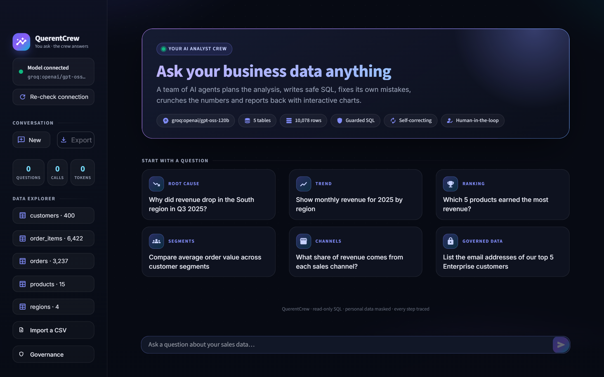
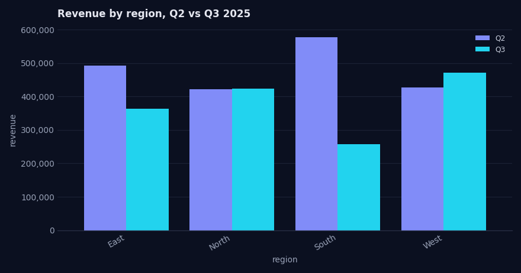
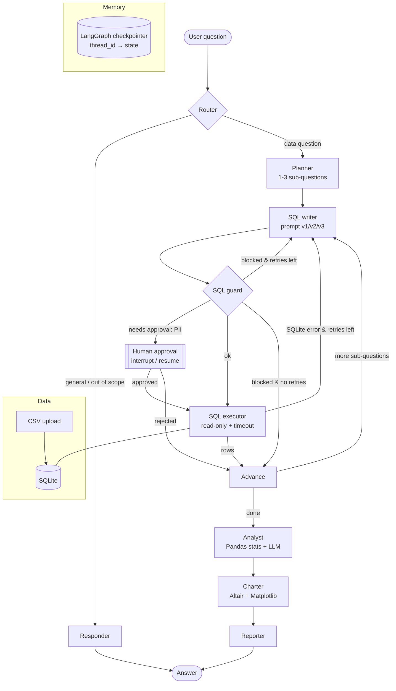

# 📊 QuerentCrew: a multi-agent analytics assistant

*Querent* (KWEER-ent): the person who asks a question, from the Latin *quaerere*, "to ask, to seek".
You are the querent. A **crew** of AI agents (planner, SQL writer, SQL guard, executor, analyst,
chart builder, reporter) works on your question and returns an answer backed by real numbers.

> Ask business questions in plain English and get a short report backed by numbers.
> A team of AI agents built with **LangChain 1.x** and **LangGraph** plans the analysis, writes safe SQL,
> fixes its own errors, crunches results with **Pandas/NumPy**, draws charts, and pauses for **human
> approval** before touching personal data. Every prompt is **versioned and measured** by an
> evaluation harness.

 
 
 




---

## Table of contents

1. [The problem](#1-the-problem)
2. [What it does (demo walkthrough)](#2-what-it-does-demo-walkthrough)
3. [Features](#3-features)
4. [Architecture](#4-architecture)
5. [The agents](#5-the-agents)
6. [Safety and governance](#6-safety-and-governance)
7. [Prompt engineering and versioning](#7-prompt-engineering-and-versioning)
8. [Evaluation](#8-evaluation)
9. [Tech stack](#9-tech-stack)
10. [Project structure](#10-project-structure)
11. [Getting started](#11-getting-started)
12. [Usage: UI, CLI, REST API](#12-usage)
13. [Configuration](#13-configuration)
14. [Testing](#14-testing)
15. [Deployment (Docker, AWS, Streamlit Cloud)](#15-deployment-docker-aws-streamlit-cloud)
16. [Design decisions](#16-design-decisions)
17. [Limitations and roadmap](#17-limitations-and-roadmap)

---

## 1. The problem

Business teams have questions like *"Why did revenue drop in the South last quarter?"*. Answering one
usually means waiting for an analyst to write SQL, export to a spreadsheet, build a chart and write
a summary. Plain "chat with your database" demos send one LLM-written query to the database and hope
for the best. They break on multi-step questions, can run dangerous SQL, leak personal data and
invent numbers.

**QuerentCrew treats the problem as an engineered workflow, not a single prompt:** planning,
guarded SQL generation with self-correction, deterministic analysis, human oversight and measured
prompt quality.

## 2. What it does (demo walkthrough)

The bundled sample database (`scripts/seed_database.py`) holds one year of sales for a fictional
company: 400 customers, about 3,200 orders and about 6,400 order lines across 4 regions, 4 product
categories, 3 segments and 3 channels. A **real business story is planted in the data**: South
region revenue falls sharply in Q3 2025 because Electronics demand and Enterprise orders drop.

**Question:** *"Why did revenue drop in the South region in Q3 2025?"*

| Step | Agent | What happens |
|---|---|---|
| 1 | **Router** | Classifies it as a `data_question` (vs. general or out-of-scope chat) |
| 2 | **Planner** | Splits it into sub-questions: (a) Q2 vs Q3 revenue by region, (b) Q2 vs Q3 South revenue by category, (c) … by customer segment |
| 3 | **SQL writer** | Writes SQLite for sub-question (a) using the schema + business glossary |
| 4 | **SQL guard** | Checks it's read-only, references real tables, adds a row LIMIT, detects PII |
| 5 | **Executor** | Runs it on a read-only connection with a timeout. If SQLite errors, the error goes back to the SQL writer, which fixes the query (up to 2 retries) |
| 6 | *loop* | Steps 3-5 repeat for each sub-question |
| 7 | **Analyst** | Pandas computes % changes, shares and peaks; the LLM turns those numbers into findings |
| 8 | **Charter** | Picks a chart type and columns (validated against the real columns; if the model declines or picks invalid columns, a heuristic chooses one). The UI draws it as an interactive Altair chart; Matplotlib renders a PNG for the API and CLI |
| 9 | **Reporter** | Writes the final Markdown answer: headline number, key findings, recommended next step |

Follow-up: *"Now show the same for the North region"*. Conversation memory (a LangGraph
checkpointer) lets the planner resolve "the same".

Personal data: *"List the emails of our top 5 Enterprise customers"*. The guard flags the `email`
column, the graph **pauses** for approval, and after approval the emails are still **masked** in the
output (`ro***@example.com`).

Sample chart generated from the bundled data:



## 3. Features

- **Multi-agent orchestration with LangGraph:** 11-node `StateGraph` with conditional routing, loops and a retry cycle
- **Planning / task decomposition:** complex questions become up to 3 SQL-sized steps
- **Self-correcting SQL:** database errors and guard rejections are fed back to the SQL agent
- **Human-in-the-loop:** LangGraph `interrupt()` pauses the run, `Command(resume=...)` continues it from the UI, CLI or API
- **Conversation memory:** per-thread state in a checkpointer; follow-up questions work
- **Structured output everywhere:** every agent returns a typed Pydantic model (`RouteDecision`, `AnalysisPlan`, `SQLDraft`, `Insights`, `ChartSpec`)
- **Deterministic analytics:** Pandas/NumPy calculate the numbers; the LLM explains them, so it doesn't invent figures
- **Defence-in-depth SQL safety:** rule-based guard, read-only SQLite URI, SQLite authorizer, query timeout, row cap
- **PII governance:** approval gate + automatic masking of personal columns
- **Versioned prompt registry:** YAML prompts, three SQL-writer versions (zero-shot → rules + glossary → few-shot + reasoning)
- **Evaluation harness:** execution accuracy on 40 gold questions (20 dev + 20 held-out, written after the prompts were frozen), repeated runs with mean and range, file fingerprints, leakage tests, resumable runs
- **Model-agnostic:** Groq, Gemini, OpenAI, Ollama (local), Anthropic or Bedrock via `init_chat_model`; automatic retry and optional fallback model
- **Observability:** token/latency tracking per agent, step trace in the UI, optional LangSmith tracing
- **Data integration:** upload any CSV; Pandas cleans headers and infers types, and it becomes a queryable table
- **Three interfaces:** Streamlit chat UI, FastAPI REST API (with OpenAPI docs), terminal CLI
- **Engineering:** OOP with dependency injection, 77 pytest tests that need **no API key**, Docker, Docker Compose, GitHub Actions CI, AWS deployment guide

## 4. Architecture



**Layers**

| Layer | Module | Responsibility |
|---|---|---|
| Interfaces | `app/streamlit_app.py`, `app/style.css`, `api.py`, `__main__.py` | UI, REST, CLI |
| Facade | `service.py` → `QuerentCrew` | `ask()`, `resume()`, `history()`, `import_csv()` |
| Orchestration | `graph.py` | LangGraph wiring, checkpointer |
| Agents | `nodes.py` → `AgentNodes` | One method per agent + routing functions |
| LLM | `llm.py` | `LLMClient` interface, `LangChainLLM`, `UsageTracker` |
| Prompts | `prompts/*.yaml`, `registry.py` | Versioned templates |
| Safety | `sql_safety.py` | `SQLGuard`, PII masking |
| Data | `database.py`, `analysis.py`, `charts.py` | Read-only execution, Pandas profiling, charts |
| Quality | `evaluation.py`, `evals/` | Execution-accuracy benchmark |

## 5. The agents

| Agent | Input | Output (Pydantic) | Notes |
|---|---|---|---|
| Router | question + history | `RouteDecision` | Falls back to the data path if the LLM call fails |
| Responder | question + schema | text | Explains the data and suggests example questions |
| Planner | question + history + schema + glossary | `AnalysisPlan` | Capped at `MAX_SUB_QUESTIONS`; resolves follow-ups |
| SQL writer | sub-question + schema + glossary + feedback | `SQLDraft` | Prompt version selectable; gets error feedback on retries |
| SQL guard | SQL | `GuardResult` | Rule-based, no LLM: predictable and unit-tested |
| Human approval | guard result | decision | `interrupt()`; resumes with approve/reject + comment |
| SQL executor | SQL | rows | Read-only, authorizer, timeout, row cap, PII masking |
| Analyst | results + Pandas profile | `Insights` | Numbers come from `DataProfiler`, not the LLM |
| Charter | result overview | `ChartSpec` | Spec validated against real columns; heuristic fallback |
| Reporter | insights + results + notes | Markdown | Mentions caveats, failed or rejected steps |

## 6. Safety and governance

LLM-written SQL is untrusted input, so it passes through four independent layers:

1. **`SQLGuard` (static rules):** single statement only; must start with `SELECT`/`WITH`; blocks
   `INSERT/UPDATE/DELETE/DROP/ALTER/ATTACH/PRAGMA/...` (string literals ignored, so `WHERE status =
   'delete'` is fine); unknown tables rejected with a list of valid ones; CTE names understood;
   `LIMIT` added to non-aggregated queries.
2. **Read-only connection:** `file:...?mode=ro` SQLite URI.
3. **SQLite authorizer:** denies every action except read/select/function, even if layers 1-2 were bypassed (tested).
4. **Timeout + row cap:** a progress handler aborts long queries; results are capped at `MAX_RESULT_ROWS`.

**PII:** columns listed in `PII_COLUMNS` (default `email, phone`) trigger the approval gate
(`REQUIRE_APPROVAL_FOR_PII`) and are always masked in results. `REQUIRE_APPROVAL_FOR_ALL=true` turns
on approval for every query (useful for high-risk databases).

## 7. Prompt engineering and versioning

Prompts are data, not code: `src/querentcrew/prompts/<agent>.yaml`, each with named versions and a
description. They use `$variable` templates so SQL braces never need escaping.

| SQL writer version | Technique |
|---|---|
| `v1` | Zero-shot baseline: schema only |
| `v2` | Role prompting + explicit rules (date handling, rounding, aliases, PII) + **business glossary** (how revenue, AOV and return rate are defined) |
| `v3` | v2 + **few-shot examples** + brief step-by-step reasoning field + error-repair instructions |

The glossary (`data/business_glossary.md`) is domain context kept separate from the prompt, so a new
dataset only needs a new glossary. Switch versions with `PROMPT_VERSION_SQL=v2` or compare them all
in the evaluation harness.

## 8. Evaluation

The evaluation answers one question: **does each prompt version write SQL that returns the right
data?** It was designed so that anyone can rerun it and check the numbers.

### Test sets

| Suite | File | Questions | Purpose |
|---|---|---|---|
| `dev` | `evals/dataset.json` | 20 (5 easy, 8 medium, 7 hard) | Questions the prompts were developed against |
| `holdout` | `evals/holdout.json` | 20 (5 easy, 8 medium, 7 hard) | Written **after the prompts were frozen** and never used for tuning, so it measures how well the prompts generalise to questions they weren't built for |

Every question has a hand-written **gold SQL** query. The correct answer is whatever that query returns
from the database, so the answer key is computed, not judged. Held-out questions were checked for
ambiguity: no ties in "top N" questions, no answers of 0 that a broken query could hit by accident,
and wording with only one reasonable reading.

### Metric: execution accuracy

The model's SQL is run, and its result rows are compared with the gold rows. This is the standard
metric of public text-to-SQL benchmarks such as Spider and BIRD. Column names and order may differ,
and extra columns are allowed. Values must match after rounding to one decimal place. Row order only
counts for rankings and time series. No person or LLM judges an answer.

The report includes:
- **first-try accuracy** and **final accuracy** (after the self-correction loop), per suite and per difficulty
- the **mean and min–max range over repeated runs** (LLM output varies slightly even at temperature 0)
- errors, blocked queries, average attempts, tokens and latency
- **every wrong answer, with the SQL the model wrote**
- provider failures (rate limits, outages), retried with back-off and **not** counted as wrong,
  because they measure the API, not the prompt

### Safeguards against a biased result

- **No test question appears in a prompt.** One v3 example (*"Total revenue by region in 2025"*)
  originally matched a dev question. It was replaced before the final run, and
  `test_no_test_question_leaks_into_prompt_examples` now fails if any example comes close to a test question.
- **Dev and holdout don't overlap.** `test_dev_and_holdout_do_not_overlap` checks this. It caught a
  held-out question that differed from a dev question by one word, and that question was replaced.
- **Inputs are frozen and fingerprinted.** The report lists SHA-256 hashes of the prompts, glossary,
  both test sets and the database. The database hash covers its data, not the file bytes, so a
  database regenerated with `scripts/seed_database.py` (fixed seed 42) gets the same fingerprint.
- **Every run is reported.** The final numbers come from one command with `--fresh`; no run was
  chosen or discarded.

### Reproduce it

```bash
python scripts/seed_database.py                  # same data for everyone (fixed seed)
python evals/run_eval.py --fingerprints          # compare with the hashes in the results below
python evals/run_eval.py --repeats 3 --fresh     # both suites, v1 v2 v3, 3 runs
```

Results are saved after every question (`evals/results/checkpoint.jsonl`). If the provider's daily
quota runs out (Groq's free tier allows 200k tokens/day for `gpt-oss-120b`, and one full run uses
about 130–150k), the run stops cleanly. Run the same command **without** `--fresh` later and it
continues where it stopped. The report is only written once every question has been graded. The
saved progress is tied to the model, settings and file fingerprints, so a resumed run can't mix in
answers from different inputs.

A rerun with the same model should land within the reported range. A different model gives
different numbers, which is expected, because the harness measures model plus prompt together.

### Reading the report

`evals/results/latest_report.md` contains, for each suite (`dev`, `holdout`):

| Column | Meaning |
|---|---|
| `first_try_accuracy_pct` | correct without any retry |
| `final_accuracy_pct` | correct after the self-correction loop (mean over runs) |
| `final_accuracy_range` | lowest and highest accuracy across the repeated runs |
| `easy` / `medium` / `hard_accuracy_pct` | accuracy by difficulty |
| `errors_or_blocked`, `avg_attempts` | how often the SQL failed or was rejected, and how many tries it took |
| `avg_tokens`, `avg_latency_ms` | cost and speed per question |
| `provider_failures` | API failures, reported but not scored |

It ends with every incorrect answer (the question and the SQL the model wrote) and the input
fingerprints. The **dev vs holdout** gap shows how much of the prompt quality carries over to unseen
questions, and **v1 → v2 → v3** shows what the glossary and few-shot examples add.

With `LANGSMITH_TRACING=true`, every agent call appears in LangSmith as `querentcrew.<agent>`, so you
can inspect the exact prompts behind each score.

## 9. Tech stack

| Area | Tools |
|---|---|
| Agents and orchestration | LangChain 1.x (`init_chat_model`, structured output, retry/fallback), LangGraph 1.x (`StateGraph`, `interrupt`, `Command`, checkpointer) |
| LLMs | Groq (Llama 3.3 70B, free tier), Gemini, OpenAI, Ollama (local), Bedrock (optional) |
| Observability | LangSmith (optional), built-in `UsageTracker` |
| Data | SQLite, Pandas, NumPy |
| Charts | Altair / Vega-Lite (interactive, in the UI), Matplotlib (PNG for API and CLI) |
| Validation | Pydantic v2 |
| Interfaces | Streamlit (custom dark theme, Material Symbols icons), FastAPI + Uvicorn |
| Quality | pytest (fake LLM), GitHub Actions, ruff |
| Deployment | Docker, Docker Compose, AWS EC2 / SSM Parameter Store / S3 / CloudWatch |

## 10. Project structure

```
querentcrew/
├── app/
│   ├── streamlit_app.py          # chat UI: example cards, interactive charts, data/SQL/plan/trace tabs, approval card, CSV upload
│   └── style.css                 # UI theme (dark glass design, responsive layout)
├── src/querentcrew/
│   ├── config.py                 # Settings from env / .env
│   ├── schemas.py                # Pydantic models for structured LLM output
│   ├── state.py                  # AgentState shared by the graph
│   ├── llm.py                    # LLMClient interface, LangChainLLM, UsageTracker
│   ├── nodes.py                  # the agents + routing functions
│   ├── graph.py                  # LangGraph wiring
│   ├── service.py                # QuerentCrew facade (ask / resume / history / import_csv)
│   ├── database.py               # read-only execution, schema introspection, CSV import
│   ├── sql_safety.py             # SQLGuard + PII masking
│   ├── analysis.py               # Pandas/NumPy profiler
│   ├── charts.py                 # chart spec validation + heuristic fallback, Matplotlib PNG renderer
│   ├── evaluation.py             # execution-accuracy evaluator
│   ├── api.py                    # FastAPI app
│   ├── __main__.py               # CLI: python -m querentcrew
│   └── prompts/                  # registry.py + versioned YAML prompts
├── evals/
│   ├── dataset.json              # dev suite: 20 gold questions
│   ├── holdout.json              # held-out suite: 20 gold questions written after the prompts were frozen
│   ├── run_eval.py               # compare prompt versions (repeats, resume, fingerprints)
│   └── results/                  # generated reports
├── data/business_glossary.md     # metric definitions used in prompts
├── scripts/seed_database.py      # reproducible sample database with a planted story
├── tests/                        # 77 tests, fake LLM, no API key needed
├── docs/DEPLOY_AWS.md            # step-by-step AWS deployment
├── Dockerfile, docker-compose.yml, Makefile, pyproject.toml, requirements.txt
└── .github/workflows/ci.yml      # lint + tests on 3.11/3.12 + Docker build
```

## 11. Getting started

**Prerequisites:** Python 3.11+ and one LLM option. The quickest free one is a **Groq API key**
from <https://console.groq.com>. Alternatives: a Gemini key from <https://aistudio.google.com>, or
[Ollama](https://ollama.com) for a fully local model.

```bash
git clone https://github.com/Himanshu-joshi986/querentcrew.git
cd querentcrew

python -m venv .venv
# Windows: .venv\Scripts\activate      macOS/Linux: source .venv/bin/activate

pip install -r requirements.txt
pip install -e .

cp .env.example .env            # Windows: copy .env.example .env
# edit .env -> set LLM_MODEL and the matching API key

python scripts/seed_database.py # creates data/sales.db (optional: the app also builds it on first start)
pytest                          # optional: all tests pass without an API key
streamlit run app/streamlit_app.py
```

Open <http://localhost:8501> and click one of the example question cards, or type your own question.

## 12. Usage

### Streamlit UI
- **Welcome screen:** six example question cards (root cause, trend, ranking, segments, channels, governed data). Click one or type your own question.
- **Live progress:** while the agents work, each step (planner, SQL writer, guard, executor...) appears as it happens.
- **Every answer** is a Markdown report followed by a stats strip (queries OK, rows, LLM calls, tokens, time) and tabs:
  - **Chart:** interactive chart (hover for exact values, highlighted series and bars, donut with total)
  - **Data:** result table per step, numbers with thousands separators, **CSV download**
  - **SQL:** the exact query per step, number of attempts and run time
  - **Plan:** the sub-questions and the analyst's caveats
  - **Agent trace:** timeline of every agent step, with raw details on demand
- **Approval card** with **Approve and run / Reject** and an optional comment when a query needs review
- **Sidebar:** model connection status, new conversation, **export chat as Markdown**, session totals,
  data explorer (click a table to preview 50 rows and its columns), **CSV import** and governance settings
- Responsive layout: works on laptop and phone screens (the sidebar collapses on small screens)

### CLI
```bash
python -m querentcrew                                    # interactive chat
python -m querentcrew "Which 5 products earned the most revenue?"
```
Charts are saved to `outputs/`.

### REST API
```bash
uvicorn querentcrew.api:app --reload --port 8000         # docs at http://localhost:8000/docs
```

| Method | Endpoint | Purpose |
|---|---|---|
| GET | `/health` | Liveness check |
| GET | `/schema` | Tables, columns, row counts |
| POST | `/ask` | `{"question": "...", "thread_id": "optional"}` |
| POST | `/approve` | `{"thread_id": "...", "approved": true, "comment": ""}` |
| GET | `/history/{thread_id}` | Conversation memory |
| POST | `/upload-csv` | Multipart CSV → new table |

```bash
curl -X POST localhost:8000/ask -H "Content-Type: application/json" \
     -d '{"question": "Show monthly revenue for 2025 by region"}'
```

The response contains `status` (`completed` / `awaiting_approval`), `answer`, `plan`, `results`
(SQL + rows), `insights`, `chart.image_b64`, `trace` and `usage`.

### Using your own data
Upload a CSV in the UI (sidebar → **Import a CSV**) or with `POST /upload-csv`, or point
`DATABASE_PATH` at your own SQLite file. On import, Pandas cleans the headers (for example
`Annual Salary (USD)` becomes `annual_salary__usd`) and infers the column types. The table can then be
queried right away, because the agents re-read the schema.

Checked with a non-sales dataset (200 employees: department, hire date as `dd/mm/yyyy`, salary,
phone). Questions such as *"average salary by department"*, *"employees hired each year"* and
*"employees hired between March 2021 and June 2022"* returned correct SQL, results and charts.
*"Phone numbers of the top 3 engineers"* paused for approval and returned masked numbers.

For the best accuracy on your own data:

1. **Rewrite `data/business_glossary.md`** with your metric definitions. The bundled glossary and
   the SQL writer's few-shot examples are written for the sales sample, so this is the single most
   useful change.
2. **List your personal-data columns in `PII_COLUMNS`.** Columns are matched by **name**, so a
   column called `mobile`, `address` or `ssn` is not protected until you add it.
3. **Prefer ISO dates (`YYYY-MM-DD`).** Dates are stored as they appear in the CSV. The model
   usually handles other formats, but an ambiguous date such as `03/04/2024` can be read the wrong way.
4. Importing a file with the same name as an existing table **replaces** that table.

### Where your data lives (local storage and privacy)
- **Storage is local.** All data lives in a single SQLite file (`DATABASE_PATH`, default
  `data/sales.db`). Uploaded CSVs become new tables in that same file and stay there after a restart.
  Nothing is downloaded from the internet, and the database is opened **read-only** for queries.
- **What goes to the LLM provider.** With a hosted model (Groq, Gemini, OpenAI...), each question
  sends the provider the table and column names, **2 sample rows per table**, and a preview of each
  query result so the analyst and reporter can describe it. PII columns are masked **before** results
  reach the model. The full database is never uploaded.
- **Fully offline option.** Set `LLM_MODEL=ollama:<model>` to run a local model with
  [Ollama](https://ollama.com), so no data leaves your machine.

## 13. Configuration

All settings live in `.env` (see `.env.example`):

| Variable | Default | Meaning |
|---|---|---|
| `LLM_MODEL` | `groq:openai/gpt-oss-120b` | `provider:model` for `init_chat_model` |
| `LLM_FALLBACK_MODEL` | – | Used automatically if the primary model fails |
| `LLM_TEMPERATURE` | `0` | Deterministic output for SQL |
| `LANGSMITH_TRACING` / `LANGSMITH_API_KEY` | `false` | Turn on LangSmith tracing |
| `DATABASE_PATH` | `data/sales.db` | SQLite file |
| `MAX_RESULT_ROWS` | `500` | Row cap per query |
| `QUERY_TIMEOUT_SECONDS` | `10` | Abort slow queries |
| `MAX_SQL_RETRIES` | `2` | Self-correction attempts after the first try |
| `MAX_SUB_QUESTIONS` | `3` | Planner limit |
| `PROMPT_VERSION_SQL` | `v3` | SQL writer prompt version |
| `PII_COLUMNS` | `email,phone` | Columns that need approval and are masked |
| `REQUIRE_APPROVAL_FOR_PII` | `true` | Approval gate for PII |
| `REQUIRE_APPROVAL_FOR_ALL` | `false` | Approval gate for every query |

## 14. Testing

```bash
pytest -v
```

The LLM sits behind the `LLMClient` interface, so tests inject a scripted `FakeLLM`
(`tests/fakes.py`) and run the **real** graph, database, guard and analysis code with no API key or
network:

| File | Covers |
|---|---|
| `test_sql_safety.py` | blocked statements, string literals, CTEs, LIMIT injection, PII detection, masking |
| `test_database.py` | read-only enforcement even if the guard is bypassed, row cap, errors, CSV import |
| `test_analysis.py` | period-over-period, shares, wide comparisons, type cleaning, chart fallback |
| `test_prompts.py` | every prompt version renders with no missing variables |
| `test_nodes.py` | retry with error feedback, guard rewrite, retries exhausted, approval/rejection, masking, chart fallback when the model declines |
| `test_graph.py` | full pipeline, self-correction, interrupt/resume, rejection path, multi-turn memory |
| `test_evaluation.py` | result matching, gold SQL validity (dev + holdout), no prompt/test leakage, no dev/holdout overlap, rate-limit retry, daily-quota stop, report writing |
| `test_api.py` | REST endpoints including the ask → approve flow |
| `test_llm_errors.py` | provider error classification, fail-fast with a clear message when the model is unreachable or drops mid-run, step-by-step progress streaming |

CI (`.github/workflows/ci.yml`) runs ruff and the test suite on Python 3.11 and 3.12, then builds the Docker image.

## 15. Deployment (Docker, AWS, Streamlit Cloud)

```bash
docker compose up --build       # UI on :8501, API on :8000
```

Full AWS guide: **[docs/DEPLOY_AWS.md](docs/DEPLOY_AWS.md)**. It covers EC2 (free-tier instance) with
Docker Compose, the API key in **SSM Parameter Store**, an IAM instance role, a security group,
**S3** backups, **CloudWatch** logs, optional **Bedrock**, a cost budget and clean-up.

### Free hosting on Streamlit Community Cloud

1. Push the repository to GitHub, then go to <https://share.streamlit.io> → **Create app**.
2. Choose the repository and set the main file to `app/streamlit_app.py`.
3. Under **Advanced settings → Secrets**, add your model settings (they become environment variables):
   ```toml
   LLM_MODEL = "groq:openai/gpt-oss-120b"
   GROQ_API_KEY = "your-key"
   ```
4. Deploy. The sample database is created automatically on first start.

On the free tier, the app sleeps after a period with no visitors, and uploaded CSVs last only until
the next restart. Everyone who opens a public app uses your API quota, so use a free-tier key.

## 16. Design decisions

- **Explicit `StateGraph` instead of one ReAct agent:** a data workflow has known stages. Explicit
  nodes make routing, retries and approval points predictable, testable and visible in traces. The
  LLM decides *content* (plan, SQL, findings), and the graph decides *control flow*.
- **The LLM never does arithmetic:** `DataProfiler` computes the changes and shares the analyst cites,
  which removes the most common source of wrong numbers in LLM reports.
- **Rule-based guard, not an LLM judge, for safety:** safety checks must be deterministic and unit-testable.
- **Dependency injection:** `AgentNodes` receives its LLM, database, guard, prompts and interrupt
  function, so the same graph runs in production and in tests.
- **Plain JSON-friendly state:** state can be checkpointed and sent over the API unchanged.
- **Prompts as versioned data with an eval harness:** prompt changes are judged by measured accuracy, not by feel.

## 17. Limitations and roadmap

- SQLite only. Next: a Postgres/MySQL connector using a read-only DB user.
- In-memory checkpointer, so memory resets on restart. Next: `langgraph-checkpoint-postgres` or SQLite saver.
- The guard's table/column parsing is regex-based. Next: `sqlglot` AST parsing.
- Single-tenant demo, no auth. Next: Cognito/OIDC on the AWS deployment.
- PII detection is by column name (`PII_COLUMNS`). Next: value-based detection (email/phone patterns).
- CSV dates are stored as given. Next: normalise date columns to ISO `YYYY-MM-DD` on import.
- The prompts' few-shot examples are sales-specific. Next: generate examples from the glossary per dataset.
- The evaluation measures SQL accuracy only. Next: LLM-as-judge scoring of report quality.
- Next features: a schema-RAG retriever for databases with hundreds of tables, scheduled report emails.

---

**Author:** Himanshu Joshi · [GitHub](https://github.com/Himanshu-joshi986) · [LinkedIn](https://linkedin.com/in/himanshu-joshi-735066292/)
